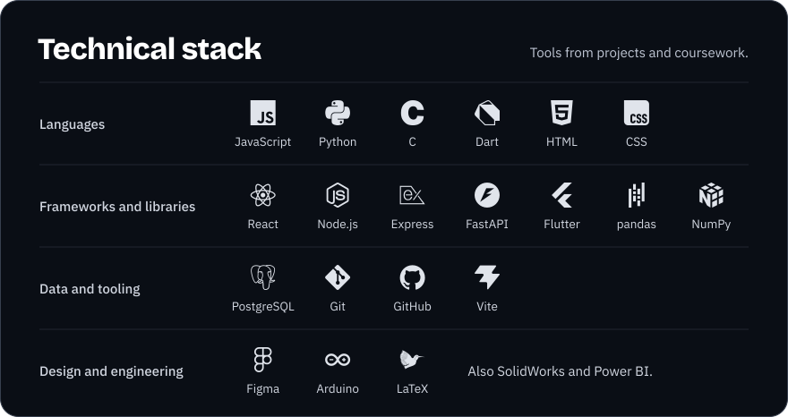

<picture>
  <source media="(max-width: 600px), (min-width: 768px) and (max-width: 900px)" srcset="assets/hero-mobile.svg">
  
</picture>

  <a href="https://linkedin.com/in/raimundononato-eng"><picture><source media="(max-width: 480px)" srcset="assets/button-linkedin-compact.svg"></picture></a>
  &nbsp;
  <a href="https://x.com/nonato_eng"><picture><source media="(max-width: 480px)" srcset="assets/button-x-compact.svg"></picture></a>
  &nbsp;
  <a href="mailto:nonato.raimundo@ime.eb.br"><picture><source media="(max-width: 480px)" srcset="assets/button-email-compact.svg"></picture></a>

<a href="https://lunetaoportunidades.com.br">
<picture>
  <source media="(max-width: 600px), (min-width: 768px) and (max-width: 900px)" srcset="assets/luneta-mobile.svg">
  
</picture>
</a>

<a href="https://lunetaoportunidades.com.br">Visit Luneta</a> or read the <a href="https://github.com/luneta-oportunidades/luneta-documentacao">public documentation</a> (in Portuguese). The source code is private.

<a href="https://github.com/R15N-eng/Hackaton_Claude_Lab/tree/main/backend/engine">
<picture>
  <source media="(max-width: 600px), (min-width: 768px) and (max-width: 900px)" srcset="assets/match-carioca-mobile.svg">
  
</picture>
</a>

Check it yourself (method notes are in Portuguese): the <a href="https://github.com/R15N-eng/Hackaton_Claude_Lab/tree/main/backend/engine">engine, method and limitations</a>, <a href="https://github.com/R15N-eng/Hackaton_Claude_Lab/blob/main/backend/engine/simulate.py"><code>simulate.py</code></a>, which reproduces the numbers, and the team's <a href="https://github.com/R15N-eng/Hackaton_Claude_Lab/commits/main">commit history</a>.

### Also built

- **Automated catapult**, IME introductory engineering project. I led a group of six, planned the project with PMBOK, and wrote the Flutter app that sets the distance and fires over Bluetooth. Arduino UNO on the hardware side. It hit its target.
- [**Game Guide API**](https://github.com/R15N-eng/Game-Guide-Api), a REST API for tracking game achievements with Node.js, Express and PostgreSQL. Learning project, in development.
- [**Task App**](https://github.com/R15N-eng/Task---App), a task manager with React, Express and PostgreSQL. Learning project, in development.

<picture>
  <source media="(max-width: 600px), (min-width: 768px) and (max-width: 900px)" srcset="assets/stack-mobile.svg">
  
</picture>

<picture>
  <source media="(max-width: 600px), (min-width: 768px) and (max-width: 900px)" srcset="assets/background-mobile.svg">
  
</picture>

The graphics are original and generated by <a href="tools/build_assets.py"><code>tools/build_assets.py</code></a>. Icons come from <a href="https://simpleicons.org">Simple Icons</a> and <a href="https://fontawesome.com/license/free">Font Awesome Free</a> (CC BY 4.0). Logos belong to their owners.
