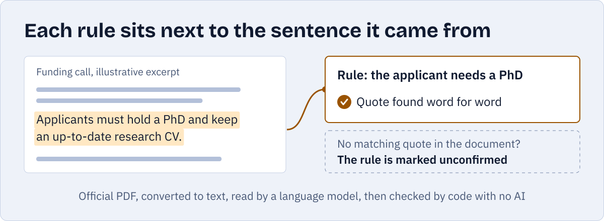
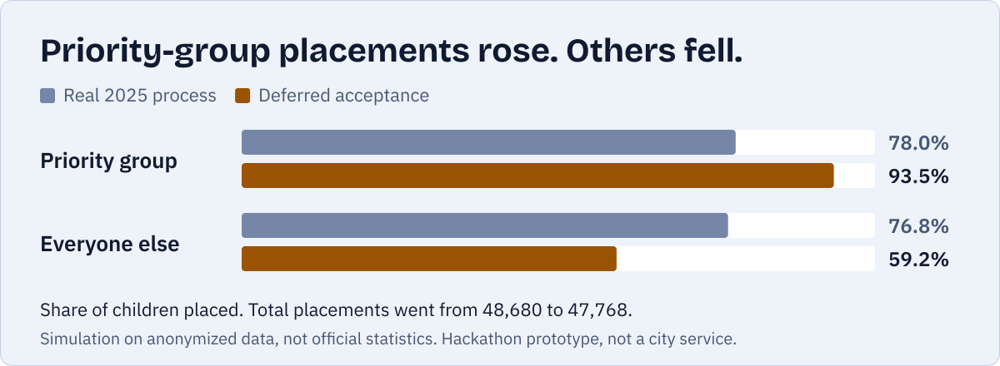

<picture>
  <source media="(max-width: 600px) and (prefers-color-scheme: dark)" srcset="assets/header-mobile-dark.svg">
  <source media="(max-width: 600px) and (prefers-color-scheme: light)" srcset="assets/header-mobile-light.svg">
  <source media="(prefers-color-scheme: dark)" srcset="assets/header-dark.svg">
  
</picture>

I'm Raimundo, a Computer Engineering student at Instituto Militar de Engenharia (IME) and co-founder of LEPV, an entrepreneurship league. I build web products, and I like results that someone else can check: a quote you can find in the source, a simulation you can run again.

<a href="https://linkedin.com/in/raimundononato-eng"><picture>
  <source media="(prefers-color-scheme: dark)" srcset="assets/button-linkedin-dark.svg">
  
</picture></a>
<a href="mailto:nonato.raimundo@ime.eb.br"><picture>
  <source media="(prefers-color-scheme: dark)" srcset="assets/button-email-dark.svg">
  
</picture></a>

## Selected work

### Luneta: research funding calls, with the evidence

<picture>
  <source media="(max-width: 600px) and (prefers-color-scheme: dark)" srcset="assets/luneta-mobile-dark.svg">
  <source media="(max-width: 600px) and (prefers-color-scheme: light)" srcset="assets/luneta-mobile-light.svg">
  <source media="(prefers-color-scheme: dark)" srcset="assets/luneta-dark.svg">
  
</picture>

Calls for research funding are long and dense. Luneta gathers calls from Brazilian funding agencies and shows each extracted rule beside the passage of the official document it came from. It is a screening tool and does not replace reading the call.

- **My part:** project management, product discovery, brand and site copy; accountable for site and user experience in a team of five.
- **Team's stack:** Python, Docling, language models with a deterministic quote validator, Next.js, TypeScript.
- **Status:** published. As of 13 November 2026 it listed 179 calls from 10 agencies and was integrated into the InovaIME portal. Built in an IME engineering project course.

[Visit Luneta](https://lunetaoportunidades.com.br) or [read the public documentation](https://github.com/luneta-oportunidades/luneta-documentacao) (in Portuguese; the source code is private).

### Match Carioca: a different way to allocate daycare seats

<picture>
  <source media="(max-width: 600px) and (prefers-color-scheme: dark)" srcset="assets/match-carioca-mobile-dark.svg">
  <source media="(max-width: 600px) and (prefers-color-scheme: light)" srcset="assets/match-carioca-mobile-light.svg">
  <source media="(prefers-color-scheme: dark)" srcset="assets/match-carioca-dark.svg">
  
</picture>

This prototype compares Rio's 2025 daycare allocation, made option by option, with an allocation made child by child using deferred acceptance (Gale–Shapley). The chart shows the trade-off: it moves seats toward the priority group (score of 51 or more), places fewer of the other children and places 912 fewer in total. You can rerun the numbers with [`simulate.py`](https://github.com/R15N-eng/Hackaton_Claude_Lab/blob/main/backend/engine/simulate.py).

- **My part:** front end for the family and city-office views, integration of the allocation engine into the API, and documentation. This was a team project; the [commit history](https://github.com/R15N-eng/Hackaton_Claude_Lab/commits/main) shows who did what.
- **Built with:** HTML, CSS, JavaScript, Python, FastAPI.
- **Status:** hackathon prototype from Claude Impact Lab Rio #2. It is not an official service of the Rio city government, and its notifications are simulated.

[Code, method and limitations](https://github.com/R15N-eng/Hackaton_Claude_Lab) (in Portuguese).

### Earlier work, where I learned the back end

- [**Game Guide API**](https://github.com/R15N-eng/Game-Guide-Api): REST API for tracking game achievements, with Node.js, Express and PostgreSQL. Password hashing and JWT-protected progress routes. In development.
- [**Task App**](https://github.com/R15N-eng/Task---App): full-stack task manager with React, Express and PostgreSQL. In development.

## Toolbox

- **In the public code above:** JavaScript, HTML and CSS, React, Node.js and Express, Python and FastAPI, PostgreSQL, Git.
- **Also work with:** Flutter and Dart, C, Arduino, Figma, LaTeX, Power BI, SolidWorks.
- **Product:** discovery, project management and interface copy, practiced on Luneta.

## Background

| When | Role |
|---|---|
| 2026 to now | Co-founder, LEPV (Liga de Empreendedorismo da Praia Vermelha) |
| 2025 to now | Front-end consultant and coordinator, IME Júnior |
| 2025 to now | Member, IME Finance, a financial markets league |
| 2025 | Reserve officer aspirant, Brazilian Army |

Brazilian Astronomy Olympiad (OBA): gold medal in 2020, silver in 2019.

## Now

Studying advanced React patterns, REST APIs with Node.js, mobile development with Flutter and data analysis with Python. I'm also interested in AI and game development.
